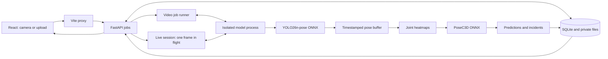

# ICare

[](https://github.com/vihaanbishnoi/ICare/actions/workflows/ci.yml)

**Temporal pose-based fall detection with a browser interface.**

ICare analyzes webcam frames and short recorded videos using YOLO26n-pose and
PoseC3D. The local React dashboard provides **Live Detection** and **Analyze
Video**, backed by FastAPI and CPU ONNX Runtime. A separate static build previews
the interface without a backend or inference service.

The current implementation is a fall-detection research baseline.
Its model choice is an existing implementation, not a claim of a final or novel
architecture. Bed-exit detection, wandering and adaptive processing are outside
the current release; extending the scope requires literature review and evaluation.

## Features

- MP4 analysis with synchronized video, poses and confidence over source time.
- Optional webcam detection with synchronized analyzed frames, measured timings
  and private timestamped incident history.
- Incident detection with de-duplication across overlapping temporal windows.
- Private browser-session jobs, cancellation and retry without duplicate submissions.
- Isolated model execution with crash recovery, bounded queues and storage admission.

## Architecture



Recorded videos are sampled at six frames per source second. The camera submits
at most six frames per wall-clock second, waits for each response, then captures
the newest frame; it never builds a frame queue. Both modes use the same
per-source temporal pipeline. YOLO26n-pose detects people
and estimates 17 COCO joints together in one pass, selecting the largest visible
person in each sampled frame. It uses a fixed 640-pixel, aspect-preserving square
input and maps boxes and joints back to source coordinates. A rolling pose window is resampled to 48
temporal positions and converted to a `1 x 17 x 48 x 64 x 64` heatmap tensor.
PoseC3D produces `No Fall` and `Fall` probabilities through ONNX Runtime. The
four-second history is a maximum context window, not a fixed alert delay.
Classification requires at least six poses spanning two seconds; gaps over one
second restart coverage. Each model uses two CPU inference threads.

An incident opens at `P(Fall) >= 0.50`. Three consecutive predictions below
`0.35` re-arm detection. The clear rule suppresses repeated alerts; it does not
establish physical recovery. Source sampling cadence and wall-clock throughput
are separate measurements.

## Run locally

Use Python 3.11 and Node 24 or newer. From the repository root in PowerShell:

```powershell
py -3.11 -m venv .venv
.\.venv\Scripts\python.exe -m pip install -r requirements.txt
.\.venv\Scripts\python.exe -m pip install --no-deps -e .
.\.venv\Scripts\python.exe -m uvicorn icare.api.main:create_app --factory --host 127.0.0.1 --port 8000
```

In a second terminal, also starting from the repository root:

```powershell
cd src/frontend
npm ci
npm run dev
```

Open the Vite URL printed in the terminal and choose **Live Detection** or
**Analyze Video**. Its proxy keeps browser requests and API cookies on the same
origin. `/api/v1/health` reports the service, and `/api/v1/ready` reports model
availability. Stop each server with **Ctrl+C** in its terminal.

MP4 uploads are limited to 50 MB and 60 seconds by default. Both ONNX weights are
included in `models/` and validated when the engine starts; inference needs no downloads.
Jobs run one at a time and private results expire after 24 hours.

Press **Start Live Detection** to request camera permission. Localhost or HTTPS
is required. The dashboard shows an uninterrupted camera preview alongside the
exact analyzed frame and its skeleton, probabilities, deduplicated alerts and
session history. Camera frames stay in memory; only incident/session metadata
is retained in SQLite. Stop releases the camera and model for video analysis.
Only one source can use inference at a time. Disconnected sessions expire after
20 idle seconds; sessions are limited to one hour.

Completed frames per session second, backend processing time and browser
capture-to-result time are measured separately. They are not camera FPS,
fall-onset detection latency or a throughput guarantee. Slow hardware may not
provide enough uninterrupted pose coverage for predictions.

The API reads shell environment variables; it does not automatically load
`.env` files. The non-secret configuration defaults are in
[.env.example](.env.example).

The product uses ONNX Runtime and headless OpenCV, without PyTorch, Ultralytics
or RTMLib at runtime. To reproduce the pose export, use a separate environment
with `requirements-export.txt` and run `python -m icare.tools.export_pose_model`.
The [pose model metadata](models/yolo26n-pose.json) records the source, export
arguments and checksums. The upstream weights use [Ultralytics licensing](https://www.ultralytics.com/license);
the upstream [license text](models/YOLO26_LICENSE) is included with the model.

The default install has seven direct dependencies: NumPy for tensors, headless
OpenCV for frames, ONNX Runtime for the models, psutil for CPU/memory measurements,
FastAPI and Uvicorn for the API, and python-multipart for video uploads. Pip also
installs their supporting dependencies automatically.

Matplotlib is optional and only needed for evaluation plots:

```powershell
.\.venv\Scripts\python.exe -m pip install -e ".[evaluation]"
```

`requirements-export.txt` is only for rebuilding the pose model in a separate
environment; it is not needed to run the included ONNX models.

## Static preview

From `src/frontend/`, run:

```sh
npm run build:static
npm run preview:static
```

Open the printed URL under `/ICare/`. This build needs no API, webcam, Python,
database or model weights. It shows empty video and results placeholders;
no sample clips, predictions or incidents are bundled. Current pipeline evaluation
metrics remain **Not yet evaluated**. It offers no upload or live-inference
controls. The static build only permits the app icons in `public/` and rejects
additional files or symlinks.

The Pages job is prepared but disabled unless the repository variable
`ICARE_PAGES_ENABLED` equals `true`. After publication approval, configure GitHub
Pages to use Actions and enable that variable. Only `dist-static/` is packaged,
after checks pass on `main`. No publication is enabled by this checkout.

## Repository layout

Application code lives in one source folder. Trained assets live in `models/`.

```text
src/
  icare/
    inference/     Camera/video → poses → heatmaps → fall probabilities
    api/           Browser requests, jobs, incidents and result exports
    evaluation/    Optional measurements and diagnostic experiments
    tools/         Single-clip runner and repository checker
  frontend/        React/Vite application
models/            Both ONNX models, metadata and pose-model license
```

To follow the baseline, start with [`engine.py`](src/icare/inference/engine.py):
`load_engine()` prepares the models and `analyze_video()` processes a clip.
[`pose.py`](src/icare/inference/pose.py) extracts joints,
[`posec3d_bridge.py`](src/icare/inference/posec3d_bridge.py) builds temporal
heatmaps, and [`engine_model.py`](src/icare/inference/engine_model.py) loads
and validates the classifier. These modules run without the browser or API:

```sh
python -m icare.tools.run_engine_clip "C:/path/to/your-video.mp4" --output artifacts/clip.json
```

Run commands from the checkout root after the editable installation. The
`evaluation/` package is optional and is not imported by the production API.

## Evaluation

The recorded training source is the [Fall Video Dataset on Kaggle](https://www.kaggle.com/datasets/payutch/fall-video-dataset).
Historical cleaning records contain 6,766 samples: 4,742 training, 1,013
validation and 1,011 test. The binary classifier was fine-tuned from an
NTU60-pretrained PoseC3D SlowOnly-R50 checkpoint with MMAction2.

| Historical group-aware test metric | Reported result |
| --- | ---: |
| Fall precision | 97.09% |
| Fall recall | 94.75% |
| Fall F1 | 95.90% |
| Overall accuracy | 96.34% |

These are historical sample-classification results at a 0.50 threshold, not
subject-independent or deployed monitoring accuracy. The original dataset,
split manifest and prediction files are not included in this repository.
They predate the YOLO26n-pose replacement and do not establish accuracy for the
current pose-to-classifier pipeline. Changing the pose estimator changes the
classifier's inputs, including joint-confidence values; labelled evaluation is
needed to measure the effect. Local diagnostic clip executions verify operation,
not accuracy preservation or improvement.

Provenance remains unresolved: `posec3d_runtime.json` names an epoch-9 checkpoint,
while the locally preserved training checkpoint is epoch 12. Neither filename
establishes which checkpoint produced the ONNX export. The records and weights
are preserved pending export-time evidence.

## Verification

After the editable installation described above, run from the root:

```sh
python -m icare.tools.check_repository
```

From `src/frontend/`:

```sh
npm run build
npm run build:static
npm run lint
```

CI runs Python syntax and repository checks, frontend lint, both builds and
credential scanning on Linux. This local inference demo has no automated test
suite. Before demonstrating inference, start the local stack and manually try a
video upload or the optional camera. Build and repository checks do not establish
model accuracy or successful inference.

## Scope and limitations

- Both modes follow one primary person; they do not establish persistent identity.
- CPU processing can take longer than the source clip. No real-time throughput guarantee is made.
- The custom rolling-window preprocessing is not proven equivalent to the original full-clip validation pipeline.
- Urgency and reliability are diagnostic signals, not an adaptive scheduler or calibrated safety assessment.

ICare is a research prototype, not a medical device or emergency response service.
