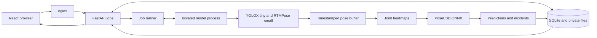

# ICare

[](https://github.com/vihaanbishnoi/ICare/actions/workflows/ci.yml)

**Temporal pose-based fall detection with a browser interface.**

ICare analyzes short recorded videos using person detection, body-pose estimation
and a temporal action classifier. Review the original video alongside skeleton
overlays, fall-confidence traces and detected incidents, then export JSON or CSV.
Inference runs locally on the CPU without an LLM, API key or mandatory webcam.

## Features

- MP4 analysis with synchronized video, poses and confidence over source time.
- Incident detection with de-duplication across overlapping temporal windows.
- Private browser-session jobs, cancellation and retry without duplicate submissions.
- Isolated model execution with crash recovery, bounded queues and storage admission.
- Reproducible Docker Compose packaging with an end-to-end inference smoke test.

## Architecture



The engine samples frames at six per source second, follows the largest detected
person and estimates 17 COCO joints. A rolling pose window is resampled to 48
temporal positions and converted to a `1 x 17 x 48 x 64 x 64` heatmap tensor.
PoseC3D produces `No Fall` and `Fall` probabilities through ONNX Runtime.

An incident opens at `P(Fall) >= 0.50`. Three consecutive predictions below
`0.35` re-arm detection. The clear rule suppresses repeated alerts; it does not
establish physical recovery. Source sampling cadence and wall-clock throughput
are separate measurements.

## Run with Docker

Start Docker Desktop or a Docker engine, then run from the repository root:

```sh
docker compose up --build -d --wait
```

Open [http://127.0.0.1:7860](http://127.0.0.1:7860) and choose **Upload Your Video**.
MP4 uploads are limited to 50 MB and 60 seconds by default. Initial builds download
and verify the pose weights; subsequent container startup uses the baked cache.
Jobs run one at a time and private results expire after 24 hours.

```sh
docker compose logs --tail 100 api web
docker compose down
```

Catalog examples require verified source, rights and labels. The bundled clips
are diagnostic inputs and remain disabled by default. For local testing only,
set `ICARE_ALLOW_UNVERIFIED_EXAMPLES=1` before starting Compose. The full set of
non-secret configuration defaults is in [.env.example](.env.example).

## Local development

Use Python 3.11 and Node 24 or newer. In PowerShell:

```powershell
py -3.11 -m venv .venv
.\.venv\Scripts\python.exe -m pip install -r requirements.txt -r api/requirements.txt
.\.venv\Scripts\python.exe -m uvicorn api.main:create_app --factory --host 127.0.0.1 --port 8000
```

In a second terminal:

```powershell
cd frontend
npm ci
npm run dev
```

Open the Vite URL printed in the terminal. Its proxy keeps browser requests and
API cookies on the same origin. The API reads shell environment variables;
Compose loads its environment separately. `/api/v1/health` reports the service,
and `/api/v1/ready` reports model availability.

## Repository layout

| Directory | Purpose |
| --- | --- |
| [icare_app/](icare_app/) | Pose extraction, temporal heatmaps and ONNX inference |
| [api/](api/) | Jobs, ownership, admission, persistence and reports |
| [frontend/](frontend/) | React interface, playback and interaction tests |
| [evaluation/](evaluation/) | Runtime measurements and pose perturbation utilities |
| [models/](models/) | Versioned classifier weights and runtime metadata |
| [examples/](examples/) | Catalog and diagnostic video inputs |
| [deployment/](deployment/) | Pinned runtime, containers, proxy and smoke test |
| [tests/](tests/) | Engine, API, admission, recovery and evaluation regressions |
| [tools/](tools/) | Clip runner, subject audit and preprocessing diagnostics |

## Evaluation

The recorded training source is the [Fall Video Dataset on Kaggle](https://www.kaggle.com/datasets/payutch/fall-video-dataset).
Historical cleaning records contain 6,766 samples: 4,742 training, 1,013
validation and 1,011 test. The binary classifier was fine-tuned from an
NTU60-pretrained PoseC3D SlowOnly-R50 checkpoint with MMAction2.

| Historical group-aware test metric | Reported result |
| --- | ---: |
| Fall precision | 97.09% |
| Fall recall | 94.75% |
| Fall F1 | 95.90% |
| Overall accuracy | 96.34% |

These are historical sample-classification results at a 0.50 threshold, not
subject-independent or deployed monitoring accuracy. The original dataset,
split manifest and prediction files are not included in this repository.

## Verification

Use a separate environment for `requirements-test.txt`; it contains test-only
headless OpenCV dependencies. From the root:

```sh
python -m tools.check_repository
python -m unittest discover -s tests -v
```

From `frontend/`:

```sh
npm test
npm run build
npm run lint
```

CI runs repository checks, Python tests on Windows/Linux, frontend tests/build,
credential scanning and a real-model Compose smoke test. With local diagnostic
examples enabled, `deployment/smoke_test.sh` exercises the running stack.
Synthetic test adapters verify behavior and are not accuracy evidence.

## Scope and limitations

- Recorded-video analysis follows one primary person; it is not continuous webcam monitoring.
- CPU processing can take longer than the source clip. No real-time throughput guarantee is made.
- The custom rolling-window preprocessing is not proven equivalent to the original full-clip validation pipeline.
- Urgency and reliability are diagnostic signals, not an adaptive scheduler or calibrated safety assessment.

ICare is a research prototype, not a medical device or emergency response service.
