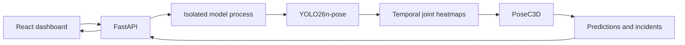

# ICare

[](https://github.com/vihaanbishnoi/ICare/actions/workflows/ci.yml)

**Pose-based fall detection with local CPU inference and a React dashboard.**

ICare combines YOLO26n-pose and PoseC3D to estimate fall probability from body
movement over time.

[Interface preview](https://vihaanbishnoi.github.io/ICare/) · [Run locally](#run-locally) · [Architecture](#architecture)

The public website is a static preview. Run locally for camera and video inference.

## Features

- **Live detection:** camera frames, skeleton overlays, fall probabilities, and incident history.
- **Video analysis:** MP4 uploads, progress/cancellation, synchronized playback, and JSON/CSV reports.
- **Dashboard:** responsive layout, light/dark themes, and keyboard-accessible mode selection.
- **Multiple people:** every person tracked with their own ID, pose window and fall alerts.
- **Fall clips:** a ~5 second video with its timestamps and a picture of where the fall began, in a 1 GB store that expires after 24 hours.
- **Danger zones:** pick the room a fixed camera watches, and each fall's position is added to that room's map, so caretakers can spot bumps or other hazards.
- **Backend:** isolated model execution, bounded queues, session-scoped results, and duplicate-alert suppression.

## Stack

**Python 3.11 · FastAPI · SQLite · React 19 · TypeScript · Vite · ONNX Runtime · OpenCV**

## Architecture



Camera and video share one temporal pipeline: 17 body joints are buffered over
up to four seconds and resampled to 48 positions for classification. Every person
in view is tracked and classified separately (see below). Inference runs outside
HTTP handlers; SQLite stores job and incident metadata.

Entry points: [`create_app()`](src/icare/api/main.py) and
[`load_engine()`](src/icare/inference/engine.py).

## Multiple people

One YOLO26n-pose pass finds every person in a frame. Each person gets a
persistent ID (`track_id`, shown as "Person 1", "Person 2", ...) matched from box
overlap and joint continuity with a short constant-velocity prediction, so people
who cross paths keep their IDs and an ID survives up to 2 s of occlusion
(`track_max_age_seconds`). Near-identical duplicate boxes for one person are merged.

Each person has their own four-second pose window, PoseC3D prediction every
0.75 s and incident rule (P(Fall) >= 0.50 opens an incident; three of that
person's predictions below 0.35 re-arm it). One person's movement never enters
another person's model input, and one person's open incident never suppresses,
clears or delays anyone else's, so simultaneous and consecutive falls by different
people are separate events. With one person in view, poses and predictions are
identical to the previous single-person pipeline (checked on the development clips). Poses, predictions, incidents and both report
formats include `track_id`; existing databases gain the column automatically.

PoseC3D costs about 0.2 s per person per prediction on a laptop CPU. Recorded
videos classify everyone; a live camera frame classifies at most two due people,
most overdue first, so a crowd slows each person's prediction rate instead of
stalling the stream. `ICARE_FALL_CONFIRMATIONS=2` requires two consecutive high
predictions per person before an incident (default 1, the baseline rule).

ICare does not label postures such as sitting, bending or lying: PoseC3D outputs
only P(Fall), and posture rules would need labelled data to validate. Per person,
the reported states are warming up (fewer than six poses spanning 2 s), monitoring,
and fall recorded (until re-armed).

## Fall clips

Every incident, from an uploaded video or a live camera, gets a clip of about
5 seconds: the 4 s before the detection timestamp (the model's own window, so the fall
is inside it) and 1 s after it. The window slides to keep its length at the start or
end of a video. The frontend plays it from
`GET /api/v1/clips/{clip_id}/video`; `GET /api/v1/clips` lists this browser's clips
with `detected_at_seconds`, `clip_start_seconds`, `duration_seconds`,
`created_at_utc`, `expires_at_utc` and the storage cap. Incidents carry a `clip_id`.
Uploaded-video timestamps are video time; live timestamps are camera-session time.

In the care portal, falls found by the detector join the manager's feed (under the room
chosen for the camera, or in a "Fall detector" room, Room DET, when none was chosen), so they
appear in Overview alerts, Live monitor, Fall incidents, the alert bell, the centred alert and
reports, and every Clip button plays the recorded video. The portal's other residents, falls and the "Simulate
fall" button are still simulated demo data; their clip dialog is labelled as a drawn
replay because no footage exists for them.

- **Storage:** clips have their own cap, default **1 GB** (`ICARE_MAX_CLIP_STORAGE_MB`).
  When a new clip would exceed it, the oldest clips are deleted first, so the newest
  falls are kept. Clips are downscaled to at most 960 px wide.
- **Expiry:** deleted 24 hours after creation (`ICARE_CLIP_RETENTION_HOURS`), swept
  every minute and at startup. Deleting a job deletes its clips; a clip can also be
  deleted on its own.
- **Privacy:** clips are private to the browser session that made them. A live camera
  is still never recorded continuously: about four seconds of frames stay in memory and
  a clip is written only when a fall is detected. A live clip is `pending` until the
  second after the fall has been captured. Live analysis can stall, so a frame arriving
  up to 1.5 s late still closes the clip, and a camera that goes quiet is saved after a
  3 s wait instead of being cut short.
- **Format:** H.264 MP4, or VP8 WebM if this OpenCV build cannot encode H.264. If neither
  is available the clip is reported as not saved rather than served in a format
  browsers cannot play. A live clip's frame rate is the rate frames were actually analyzed.

## Danger zones

A fixed camera sees the same room every time, so where people fall can be overlaid
over many clips. Choose the room (**Room** menu) when you start Live detection or analyze
a video; each fall found is then added to that room's zone. The care console's **Danger
zones** page draws every fall over the room's photo as soft red spots that deepen where
falls cluster, can switch between where the fall began and where the person landed, lists
each fall, exports CSV, and lets you remove false alarms (also done automatically when
you respond to an alert with "False alarm").

- **Two points per fall:** `onset` is where the person stood when the descent began
  (best for trip hazards, bumps and uneven flooring) and `landing` is where they ended up.
  Onset is worked out from the person's own pose track: the point where the hips started
  to drop. If no clear descent is found, onset repeats the landing point and is flagged
  `onset_estimated: false` (drawn fainter). This is a heuristic and has not been
  validated against labelled falls.
- **Coordinates:** image positions from the fixed camera, normalised to 0..1, not floor
  measurements. They only line up while the camera has not moved; if it moves, remove the
  old falls or use a new room name.
- **Picture:** each clip also gets a still of the moment the fall began, with a red ring
  where it began and an orange ring where the person landed (`GET /api/v1/clips/{id}/snapshot`).
  It shows a person, so it is deleted with the clip after 24 hours.
- **Kept long term, shared:** only the coordinates, times and a reference photo of the room
  are kept (no expiry), and they are visible to everyone using the server, so caretakers on
  different computers see the same map. The photo is the first frame found with nobody in
  it and can be replaced on the page. Clips and pictures stay private to the browser that
  recorded them. API: `GET /api/v1/rooms`, `GET /rooms/{room}/danger-zone`,
  `GET|PUT /rooms/{room}/photo`, `DELETE /rooms/{room}/falls/{id}`.
- **Few falls:** a handful of falls is a hint, not a finding; the page says so below 5.

In the care portal, a fall from a room's camera appears in that room's feed under its
resident. Falls started without a room go to the "Fall detector" room (Room DET).

## Run locally

Requires **Python 3.11** and **Node.js 24+**. Both ONNX models are included.
From the repository root in PowerShell:

```powershell
# Create once; skip this line if the environment already exists.
conda create -n icare python=3.11
conda activate icare
python -m pip install -r requirements.txt
python -m pip install --no-deps -e .
python -m uvicorn icare.api.main:create_app --factory --host 127.0.0.1 --port 8000
```

In a second terminal, from the repository root:

```powershell
cd src/frontend
npm ci
npm run dev
```

Open the Vite URL and choose **Live detection** or **Analyze video**. Keep both
terminals running; press **Ctrl+C** to stop. On later runs, skip installation.

Uploads default to **50 MB / 60 seconds**. One source uses inference at a time;
stop the camera before analyzing a video. Camera access requires localhost or HTTPS.

[Model readiness](http://127.0.0.1:8000/api/v1/ready) · [Configuration](.env.example)

## Evaluation

The current YOLO26n-pose + PoseC3D pipeline has **not been evaluated on labelled
videos**. Historical classifier results predate the pose-estimator change and
were group-aware, not verified subject-independent. Real-time performance and
preprocessing parity are unverified.

`python -m icare.evaluation.multi_person_eval --fall-clip F.mp4 --normal-clip N.mp4`
builds composite multi-person videos from real footage (a person falling, walking,
standing still or lying, tiled side by side or in a 3 × 2 grid, with time offsets
and an occluder), runs the real models and scores per-person events against the
tile labels. On the two development clips (one fall montage, one distant walker),
across 12 composite and 2 original videos:

| Pipeline | Falls detected | False or duplicate alerts | Median / max delay after onset |
| --- | ---: | ---: | --- |
| Per-person tracking (this version) | 23 / 24 | 0 | 0.97 s / 1.8 s |
| Largest person only (previous) | 3 / 24 | 0 | 0.63 s / 0.63 s |
| Per-person tracking, `ICARE_FALL_CONFIRMATIONS=2` | 23 / 24 | 0 | 1.63 s / 2.63 s |

Every tracked person was detected in at least 97.9 % of sampled frames, except
while deliberately hidden; IDs switched only inside the montage's cross-dissolve,
where two different people are briefly visible. The miss is a person who appears 1.8 s before the video ends,
too short for a 2 s window; it is detected when they stay in view. These are
composites of two clips with one actor per tile, so they test tracking, isolation
and event logic with real model outputs, not accuracy on real crowded scenes,
sitting, bending, kneeling, furniture occlusion or people of different builds.
Those need labelled multi-person recordings.

Training records reference the [Fall Video Dataset](https://www.kaggle.com/datasets/payutch/fall-video-dataset).
Classifier export provenance remains unresolved due to conflicting checkpoint
records. See [model metadata](models/posec3d_runtime.json) and
[pose export metadata](models/yolo26n-pose.json).

Research prototype; not a medical device or emergency service.
The upstream pose-model [license](models/YOLO26_LICENSE) is included.

<details>
<summary>Development and static preview</summary>

From the root: `python -m icare.tools.check_repository` and
`python -m unittest discover -s tests -t .` (tracking, per-person events, API,
storage migration and the real ONNX models; synthetic scenes test plumbing, not
fall accuracy).
From `src/frontend/`:

```sh
npm run lint
npm run build
npm run build:static
npm run preview:static
```

The static preview opens under `/ICare/`. Its homepage plays a recorded
demonstration of the local app from `src/frontend/public/demo.mp4`; until that
file exists it shows "Demo recording coming soon." It is the only video the
static build accepts, and must be a real screen recording of ICare (keep it small;
GitHub rejects files over 100 MB). With Pages enabled and
`ICARE_PAGES_ENABLED=true`, passing changes merged into `main` deploy automatically.
CI runs repository checks, the Python tests, lint, both builds, and credential
scanning. Verify local inference on real footage before demonstrating it.

Source: [`inference/`](src/icare/inference/), [`api/`](src/icare/api/),
[`frontend/`](src/frontend/). Optional experiments live in
[`evaluation/`](src/icare/evaluation/); model-export dependencies are separate in
`requirements-export.txt`.

</details>
