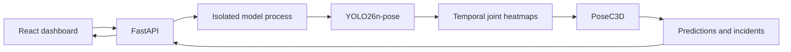

# ICare

[](https://github.com/vihaanbishnoi/ICare/actions/workflows/ci.yml)

**Pose-based fall detection with local CPU inference and a React dashboard.**

ICare combines YOLO26n-pose and PoseC3D to estimate fall probability from body
movement over time.

[Interface preview](https://vihaanbishnoi.github.io/ICare/) · [Run locally](#run-locally) · [Architecture](#architecture)

The public website is a static preview. Run locally for camera and video inference.

## Features

- **Live detection:** camera frames, skeleton overlays, fall probabilities, and incident history.
- **Video analysis:** MP4 uploads, progress/cancellation, synchronized playback, and JSON/CSV reports.
- **Dashboard:** responsive layout, light/dark themes, and keyboard-accessible mode selection.
- **Backend:** isolated model execution, bounded queues, session-scoped results, and duplicate-alert suppression.

## Stack

**Python 3.11 · FastAPI · SQLite · React 19 · TypeScript · Vite · ONNX Runtime · OpenCV**

## Architecture



Camera and video share one temporal pipeline: 17 body joints are buffered over
up to four seconds and resampled to 48 positions for classification. Inference
runs outside HTTP handlers; SQLite stores job and incident metadata.

Entry points: [`create_app()`](src/icare/api/main.py) and
[`load_engine()`](src/icare/inference/engine.py).

## Run locally

Requires **Python 3.11** and **Node.js 24+**. Both ONNX models are included.
From the repository root in PowerShell:

```powershell
# Create once; skip this line if the environment already exists.
conda create -n icare python=3.11
conda activate icare
python -m pip install -r requirements.txt
python -m pip install --no-deps -e .
python -m uvicorn icare.api.main:create_app --factory --host 127.0.0.1 --port 8000
```

In a second terminal, from the repository root:

```powershell
cd src/frontend
npm ci
npm run dev
```

Open the Vite URL and choose **Live detection** or **Analyze video**. Keep both
terminals running; press **Ctrl+C** to stop. On later runs, skip installation.

Uploads default to **50 MB / 60 seconds**. One source uses inference at a time;
stop the camera before analyzing a video. Camera access requires localhost or HTTPS.

[Model readiness](http://127.0.0.1:8000/api/v1/ready) · [Configuration](.env.example)

## Evaluation

The current YOLO26n-pose + PoseC3D pipeline has **not been evaluated on labelled
videos**. Historical classifier results predate the pose-estimator change and
were group-aware, not verified subject-independent. The baseline follows one
primary person; real-time performance and preprocessing parity are unverified.

Training records reference the [Fall Video Dataset](https://www.kaggle.com/datasets/payutch/fall-video-dataset).
Classifier export provenance remains unresolved due to conflicting checkpoint
records. See [model metadata](models/posec3d_runtime.json) and
[pose export metadata](models/yolo26n-pose.json).

Research prototype; not a medical device or emergency service.
The upstream pose-model [license](models/YOLO26_LICENSE) is included.

<details>
<summary>Development and static preview</summary>

From the root: `python -m icare.tools.check_repository`.
From `src/frontend/`:

```sh
npm run lint
npm run build
npm run build:static
npm run preview:static
```

The static showcase opens under `/ICare/` and plays
`src/frontend/public/demo.mp4`, copied from `Fall_Detection_Testing.mp4`.
The recording demonstrates the earlier YOLO Tiny + RTMPose iteration;
the local application described above uses the newer pipeline. The showcase
omits evaluation figures and requires the recording at build time.
Run `npm run dev:static -- --host 127.0.0.1` to preview it locally.
With Pages enabled and `ICARE_PAGES_ENABLED=true`, passing changes merged into
`main` deploy automatically. To publish this showcase, manually run the Checks and
static demo workflow with branch `demo` selected. Pages must use GitHub Actions
as its source and the github-pages environment must allow `demo`. This replaces
the site at the existing Pages URL.
CI runs repository checks, lint, both builds, and credential scanning. There is
no automated test suite; manually verify local inference before demonstrating it.

Source: [`inference/`](src/icare/inference/), [`api/`](src/icare/api/),
[`frontend/`](src/frontend/). Optional experiments live in
[`evaluation/`](src/icare/evaluation/); model-export dependencies are separate in
`requirements-export.txt`.

</details>
